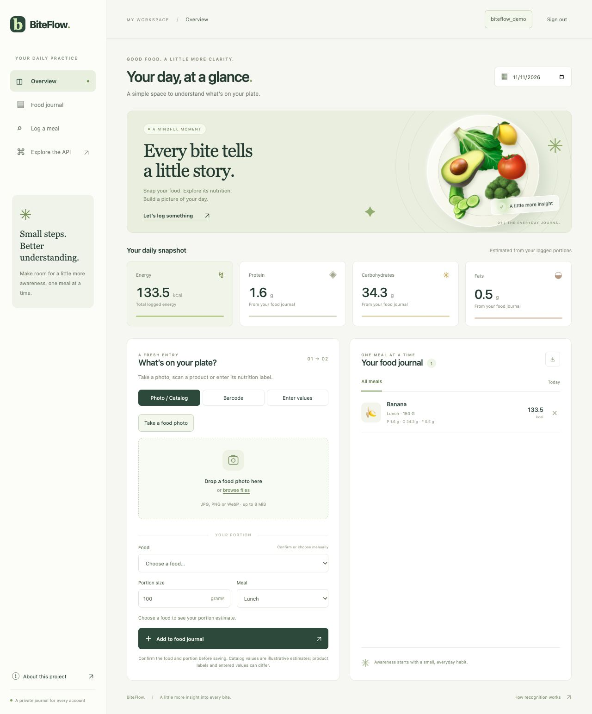

# BiteFlow

**A private food journal, built around reviewable nutrition and reliable data.**

BiteFlow combines food recognition, barcode lookup and manual logging with portion-based
nutrition tracking. It includes a **Python / FastAPI web app** and an **Expo / React Native
mobile beta** with an encrypted local meal journal and queued synchronization.

[Web app](https://foodlogger-yfn4.onrender.com) ·
[Mobile beta source](https://github.com/ophbra22/BiteFlow/tree/codex/biteflow-testflight-rc12-15/mobile) ·
[Documentation](docs/README.md) · [התחלה בעברית](docs/START_HERE_HE.md)



## Project status

| Track | Where to find it | Scope |
| --- | --- | --- |
| Web application | `main` · [live app](https://foodlogger-yfn4.onrender.com) | Browser journal, food recognition, barcode lookup and nutrition review |
| Current mobile beta | [`codex/biteflow-testflight-rc12-15`](https://github.com/ophbra22/BiteFlow/tree/codex/biteflow-testflight-rc12-15) | iOS / Android source, encrypted offline meals, sync and native integrations |
| Verification evidence | [Local-first checkpoint](https://github.com/ophbra22/BiteFlow/blob/codex/biteflow-testflight-rc12-15/docs/biteflow/local-first-checkpoint.md) | Test commands, results, limitations and rollback requirements |

The mobile beta is **not a production-readiness claim**. Physical-device validation,
photo accuracy evaluation, operational recovery and other release gates remain open.
The web and beta branches are deliberately separate; do not merge them as a deployment shortcut.
The hosted web app uses a free service and may take time to wake up.

## What it demonstrates

- **Human-reviewed nutrition:** identify a food or product, review its source and values,
  then confirm the portion. Missing nutrients remain unknown rather than becoming zero.
- **Private journals:** account-scoped meals, date navigation, nutrient totals and CSV export;
  Argon2id password hashing, opaque sessions, CSRF protection and bounded uploads.
- **Resilient mobile data:** the beta stores meals in SQLCipher, isolates storage by account
  and server, and reconciles queued writes with idempotency and conflict handling.
- **Multiple input paths:** food photos, product barcodes and manual labels in the web app;
  additional native capture and input flows in the mobile beta.
- **Testable boundaries:** nutrition calculations, authentication, API behavior, PostgreSQL,
  browser flows and mobile state have automated coverage. AI provider calls are mocked in tests.

## Architecture

```text
Web browser ───────────────────────┐
                                 ▼
                           FastAPI API ──► account-scoped PostgreSQL / SQLite
                                 │
                                 ├── food / product lookup + nutrition normalization
                                 └── recognition providers → editable suggestions

Mobile beta → encrypted SQLCipher journal → durable outbox → API acknowledgement
```

Recognition proposes a meal; the user confirms it before saving. Nutrition provenance
is distinct from model confidence. First sign-in, AI requests and uncached remote data
still require a server; the mobile outbox does not make every feature offline.

| Code | Responsibility |
| --- | --- |
| [`src/foodlogger/`](src/foodlogger/) | FastAPI, authentication, storage, nutrition and recognition |
| [`templates/`](src/foodlogger/templates/) / [`static/`](src/foodlogger/static/) | Responsive web interface |
| [Mobile source](https://github.com/ophbra22/BiteFlow/tree/codex/biteflow-testflight-rc12-15/mobile) | Expo / React Native, TypeScript and native integrations |
| [`tests/`](tests/) | Backend, API, browser and database checks |
| [`evaluations/`](evaluations/) | Reproducible evaluation protocols and fixtures |
| [`scripts/`](scripts/) | Dataset, reference-data and development helpers |
| [`docs/`](docs/README.md) | Setup, architecture, operations and verification guides |

`foodlogger` remains the internal Python package / CLI name for compatibility.
Existing API headers, cookies, database schemas and native app identifiers also remain stable.

## Run locally

Python **3.11 or 3.12** is required. This starts the journal without AI credentials or model downloads:

```bash
git clone https://github.com/ophbra22/BiteFlow.git
cd BiteFlow
python3 -m venv .venv
source .venv/bin/activate
python -m pip install -e '.[dev]'
foodlogger
```

Open [localhost:8000](http://127.0.0.1:8000). On Windows, activate with
`.venv\Scripts\Activate.ps1`. Create a local account and retain the one-time recovery code.
Manual logging works without an AI provider; unavailable recognition reports a setup message.

For optional local inference, training, configuration and Docker, see the
[development guide](docs/DEVELOPMENT.md). For native setup, use the
[mobile README on the beta branch](https://github.com/ophbra22/BiteFlow/blob/codex/biteflow-testflight-rc12-15/mobile/README.md).

## Verification

```bash
pytest
ruff check src tests scripts
ruff format --check src tests scripts
python -m build
```

Browser, PostgreSQL and ML checks have explicit dependencies and opt-in settings;
see [verification instructions](docs/DEVELOPMENT.md#verification).
Passing automated tests does not establish real-photo accuracy or device readiness.

## Recognition and data limits

The legacy classifier is a MobileNetV2 / ImageNet baseline with 23 mapped food categories,
not a Food-101 model trained by this project. Its small food catalog is illustrative.
The separate multi-food analysis pipeline uses a USDA reference extract with source metadata.
Open Food Facts product coverage and completeness vary. A photo cannot establish exact
mass, recipe or ingredients; review the food, portion and nutrition before saving.

## License and contributions

[MIT](LICENSE) for project code; models, fonts and datasets retain their
[own terms](docs/THIRD_PARTY.md). See [CONTRIBUTING.md](CONTRIBUTING.md) for branch selection,
safe tests and review expectations.
